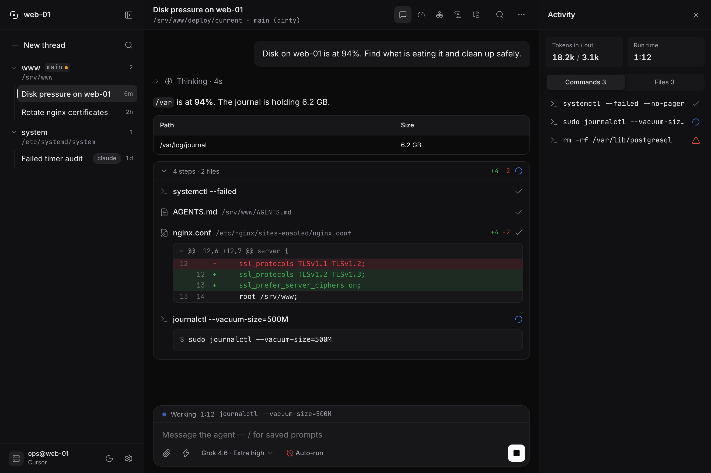
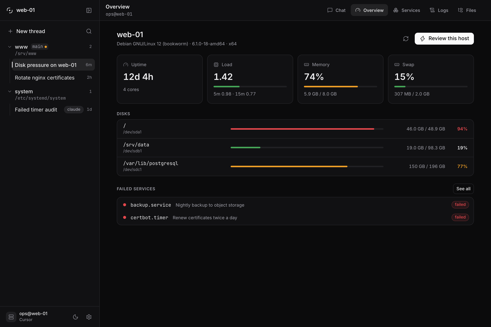

<p align="center">
  
</p>

<h1 align="center">Glassys</h1>

<p align="center">
  <strong>The coding agent on your Linux server, in a chat you can open from your phone.</strong><br/>
  Self-hosted. Built for Linux system administrators.
</p>

<p align="center">
  <a href="#english">English</a> · <a href="#español">Español</a> · <a href="https://glassys.dev">glassys.dev</a> · <a href="https://glassys.dev/demo">Demo</a>
</p>

<p align="center">
  <a href="./LICENSE"></a>
  &nbsp;
  
  &nbsp;
  
  &nbsp;
  <a href="https://github.com/KN990x/Glassys/commits/main"></a>
</p>

<p align="center">
  
</p>

<a id="english"></a>

## What it is

Your server already has a coding agent on it — Cursor, Claude Code, Codex, OpenCode or any
[ACP](https://agentclientprotocol.com) agent — signed in and able to restart a service, read the
journal or fix a config file. Talking to it still means an SSH session, and a terminal on a phone
is a poor place to follow a ten-minute run or read a diff.

Glassys is the chat window for that agent. A small Node gateway runs next to it as a
`systemd --user` service, talks to the vendor's **local SDK** (or ACP), and serves a PWA you open
from any browser: one persistent thread per workspace, the agent's thinking, tool calls and diffs
as they happen, and the machine itself one tab away.

It is for **operating a Linux host** — services, logs, disks, files, git — not for writing
applications. It is not the agent either: it does not infer and has no personality. It is the
window.

> Open WebUI is to Ollama what Glassys is to Cursor, Claude Code, Codex or OpenCode: the
> interface, not the runtime.

## For whom

- **Linux system administrators** and homelab operators who already run a coding agent on their
  servers and want to drive it from a phone or another machine.
- **Linux only.** The installer writes a `systemd --user` unit, the host views read systemd and the
  journal, and upgrades restart that unit. The browser you open it from can be anything.
- **Self-hosted.** Every operator runs their own instance. There is no Glassys cloud.

## What you get

- **The run, readable.** Thinking first, then the work: consecutive tool calls fold into one band
  (“6 steps · 3 files +4 −2”), shell calls render as a terminal block, diffs get a sign channel.
- **Activity** (`⌘I`) — every command the thread ran and how it ended, every file it read or
  rewrote. Click a row to jump to that call.
- **The host, next to the chat.** **Overview** (uptime, load, memory, swap, every disk, failed
  units), **Services** (systemd, system and user scope), **Logs** (the journal, filterable, with
  Follow) and a read-only **Files** browser. They only read: *Diagnose*, *Restart* or *Review this
  host* draft a prompt, and the agent does the work.
- **Day to day.** Command palette (`⌘K` / `Ctrl+K`), saved operations as slash templates,
  scheduled prompts (cron or a one-shot time), Web Push when a run finishes.
- **One app, two sizes.** A workspace rail on wide screens; a sheet and a bottom tab bar on a
  phone. Dark, light or system theme; English and Spanish.

<p align="center">
  
</p>

## Agents

| Agent | Transport |
| --- | --- |
| Cursor | `@cursor/sdk`, local runtime |
| Claude Code | Claude Agent SDK |
| Codex | Codex SDK (runs the Codex binary its SDK ships with) |
| OpenCode | OpenCode SDK + local server (`opencode` on PATH) |
| Gemini, and any agent in the ACP registry | Generic ACP host (`gemini --acp`) |

Never print mode: that would hide the thinking. The vendor CLI can stay installed, but its login
does not sign Glassys in — each adapter signs in through its SDK (or an API key you add in
Settings). Cursor, Claude and OpenCode list models from the live runtime catalog.

v1 is deliberately small: one profile, one live thread, one run at a time (FIFO queue). Archived
threads stay readable.

## Install

On the Linux server the agent should operate, as the user it should act as (not root):

```bash
curl -fsSL https://raw.githubusercontent.com/KN990x/Glassys/main/scripts/install.sh | bash
```

You need **Linux with systemd**, **Node.js 22.13+** and **pnpm** (`corepack enable`; on Node 25+
install Corepack first with `npm install -g corepack`). The script clones the repository, builds
it and starts `~/.config/systemd/user/glassys.service`, so closing the terminal does not stop
Glassys. On a headless server it enables linger so logging out does not stop it either (or prints
`sudo loginctl enable-linger $USER` if it cannot).

Then open `http://127.0.0.1:8787` and finish the setup wizard: operator password, agent,
workspace path and the agent's sign-in. Setup from another device asks for the one-time
**setup code** the installer prints.

```bash
cd glassys && pnpm run service:status     # systemctl --user status glassys
cd glassys && pnpm run service:upgrade    # git pull, install, build, restart; checks /health
cd glassys && pnpm run service:uninstall  # keeps the clone and data/
journalctl --user -u glassys -f           # logs
```

**Upgrade** in Settings runs the same path from the PWA. The gateway binds to `127.0.0.1` by
default; for a public URL put Caddy or Cloudflare Tunnel in front
([docs/deploy/host.md](docs/deploy/host.md)).

## Security

Glassys with auto-run and a host workspace is **operator access to that machine**, and it is built
knowing that. Read [SECURITY.md](SECURITY.md).

- Operator auth is always on, also behind Cloudflare Access or another identity proxy.
- Whoever sets the operator password owns the instance, so remote setup needs the one-time code.
- Glassys's data directory (secrets, sessions) is never browsable, and Settings warns when the
  workspace sits inside it.
- With auto-run off, Cursor uses Auto-review (risky calls are denied) and ACP denies writes and
  terminals. Cursor, Codex, OpenCode and Gemini run their tools in their own process: only a
  sandbox or a separate workspace keeps them out of a path.
- Runs travel over a WebSocket with keepalive, so a reverse proxy does not cut a long run.

## Configuration

Non-secret settings live in `$GLASSYS_DATA_DIR/config.yaml` (see
[config.example.yaml](config.example.yaml)); bind, port, allowed origins, `trustProxy` and edge
auth are yaml or env only. Secrets (operator hash, JWT secret, optional API keys) live in env or
`$GLASSYS_DATA_DIR/secrets.json`. The full reference — adapters, reverse proxy, Cloudflare Access,
security model — is at **[glassys.dev/docs](https://glassys.dev/docs)**.

## Development

```bash
pnpm install
pnpm run dev     # PWA on 127.0.0.1:5173, gateway on 127.0.0.1:8787
pnpm check       # lint, build, typecheck, tests, bundle budget
```

| Path | Role |
| --- | --- |
| `protocol/` | Versioned UI protocol |
| `gateway/` | Auth, WebSocket, queue, host probes, static PWA, adapter registry |
| `adapters/` | One package per agent (`cursor`, `claude`, `codex`, `opencode`, `gemini`, `acp`) and their contract |
| `web/` | The PWA |
| `scripts/` | Installer and the `systemd --user` service |
| `docs/deploy/` | Host, Caddy and Cloudflare recipes |

See [CONTRIBUTING.md](CONTRIBUTING.md). Licensed under [Apache-2.0](LICENSE).

---

<a id="español"></a>

<h2 align="center">Español</h2>

<p align="center">
  <strong>El agente de código de tu servidor Linux, en un chat que abres desde el móvil.</strong><br/>
  Autoalojado. Hecho para administradores de sistemas Linux.
</p>

## Qué es

Tu servidor ya tiene un agente de código — Cursor, Claude Code, Codex, OpenCode o cualquier agente
[ACP](https://agentclientprotocol.com) — con su sesión iniciada y capaz de reiniciar un servicio,
leer el journal o arreglar un archivo de configuración. Pero hablar con él sigue exigiendo una
sesión SSH, y una terminal en el móvil es mal sitio para seguir una ejecución de diez minutos o
leer un diff.

Glassys es la ventana de chat de ese agente. Un gateway pequeño en Node corre a su lado como
servicio `systemd --user`, habla con el **SDK local** del fabricante (o con ACP) y sirve una PWA
que abres desde cualquier navegador: un hilo persistente por workspace, el razonamiento, las
herramientas y los diffs del agente en directo, y la propia máquina a una pestaña de distancia.

Sirve para **operar un host Linux** — servicios, logs, discos, archivos, git —, no para programar
aplicaciones. Tampoco es el agente: no infiere y no tiene personalidad. Es la ventana.

> Lo que Open WebUI es a Ollama, Glassys lo es a Cursor, Claude Code, Codex u OpenCode: la
> interfaz, no el runtime.

## Para quién

- **Administradores de sistemas Linux** y operadores de homelab que ya tienen un agente de código
  en sus servidores y quieren manejarlo desde el móvil u otra máquina.
- **Solo Linux.** El instalador escribe una unidad `systemd --user`, las vistas del host leen
  systemd y el journal, y las actualizaciones reinician esa unidad. El navegador desde el que lo
  abres puede ser cualquiera.
- **Autoalojado.** Cada operador monta la suya. No hay nube de Glassys.

## Qué tiene

- **La ejecución, legible.** Primero el razonamiento y después el trabajo: las llamadas seguidas se
  agrupan en una banda («6 pasos · 3 archivos +4 −2»), las de shell se pintan como un bloque de
  terminal y los diffs llevan canal de signo.
- **Actividad** (`⌘I`): cada comando del hilo y cómo terminó, cada archivo leído o reescrito. Al
  pulsar una fila, salta a esa llamada.
- **El host, junto al chat.** **Resumen** (encendido, carga, memoria, swap, cada disco, unidades
  con fallos), **Servicios** (systemd, de sistema y de usuario), **Logs** (el journal, con filtros
  y Seguir) y un explorador de **Archivos** de solo lectura. Solo leen: *Diagnosticar*,
  *Reiniciar* o *Revisar este host* redactan un prompt, y el agente hace el trabajo.
- **En el día a día.** Paleta de comandos (`⌘K` / `Ctrl+K`), operaciones guardadas como plantillas
  slash, prompts programados (cron o una hora única) y notificaciones push al terminar una
  ejecución.
- **Una app, dos tamaños.** Rail de workspaces en pantalla ancha; hoja y barra de pestañas en el
  móvil. Tema oscuro, claro o del sistema; inglés y español.

## Agentes

| Agente | Transporte |
| --- | --- |
| Cursor | `@cursor/sdk`, runtime local |
| Claude Code | Claude Agent SDK |
| Codex | SDK de Codex (ejecuta el binario que trae su SDK) |
| OpenCode | SDK de OpenCode + servidor local (`opencode` en el PATH) |
| Gemini y cualquier agente del registro ACP | Host ACP genérico (`gemini --acp`) |

Nunca en print mode: ocultaría el razonamiento. El CLI del fabricante puede seguir instalado, pero
su login no autentica a Glassys: cada adaptador inicia sesión con su SDK (o con una API key que
añades en Ajustes). Cursor, Claude y OpenCode listan los modelos del catálogo vivo del runtime.

La v1 es pequeña a propósito: un perfil, un hilo vivo y una ejecución a la vez (cola FIFO). Los
hilos archivados se siguen pudiendo leer.

## Instalación

En el servidor Linux que debe operar el agente, con el usuario con el que debe actuar (no root):

```bash
curl -fsSL https://raw.githubusercontent.com/KN990x/Glassys/main/scripts/install.sh | bash
```

Hace falta **Linux con systemd**, **Node.js 22.13+** y **pnpm** (`corepack enable`; en Node 25+,
instala antes Corepack con `npm install -g corepack`). El script clona el repositorio, lo construye
y arranca `~/.config/systemd/user/glassys.service`, así que cerrar la terminal no para Glassys. En
un servidor sin pantalla activa linger para que cerrar la sesión tampoco lo pare (o imprime
`sudo loginctl enable-linger $USER` si no puede).

Después abre `http://127.0.0.1:8787` y completa el asistente: contraseña de operador, agente, ruta
del workspace e inicio de sesión del agente. El setup desde otro dispositivo pide el **código de un
solo uso** que imprime el instalador.

```bash
cd glassys && pnpm run service:status     # systemctl --user status glassys
cd glassys && pnpm run service:upgrade    # git pull, install, build, reinicio; comprueba /health
cd glassys && pnpm run service:uninstall  # conserva el clon y data/
journalctl --user -u glassys -f           # logs
```

**Actualizar** en Ajustes hace lo mismo desde la PWA. El gateway escucha en `127.0.0.1` por
defecto; para una URL pública, pon Caddy o Cloudflare Tunnel delante
([docs/deploy/host.md](docs/deploy/host.md)).

## Seguridad

Glassys con auto-run y un workspace del host es **acceso de operador a esa máquina**, y está
construido sabiéndolo. Lee [SECURITY.md](SECURITY.md).

- La autenticación de operador va siempre, también detrás de Cloudflare Access u otro proxy de
  identidad.
- Quien fija la contraseña de operador se queda con la instancia, así que el setup remoto pide el
  código de un solo uso.
- El directorio de datos de Glassys (secretos, sesiones) nunca se puede explorar, y Ajustes avisa
  si el workspace está dentro.
- Con auto-run desactivado, Cursor usa Auto-review (deniega las llamadas arriesgadas) y ACP deniega
  escrituras y terminales. Cursor, Codex, OpenCode y Gemini ejecutan sus herramientas en su propio
  proceso: solo un sandbox o un workspace aparte los mantiene fuera de una ruta.
- Las ejecuciones van por WebSocket con keepalive, así que un proxy inverso no corta una ejecución
  larga.

## Configuración

Los ajustes que no son secretos van en `$GLASSYS_DATA_DIR/config.yaml` (ver
[config.example.yaml](config.example.yaml)); bind, puerto, orígenes permitidos, `trustProxy` y la
autenticación en el borde solo se cambian en yaml o variables de entorno. Los secretos (hash de
operador, secreto JWT, API keys opcionales) van en variables de entorno o en
`$GLASSYS_DATA_DIR/secrets.json`. La referencia completa — adaptadores, proxy inverso, Cloudflare
Access, modelo de seguridad — está en **[glassys.dev/es/docs](https://glassys.dev/es/docs)**.

## Desarrollo

```bash
pnpm install
pnpm run dev     # PWA en 127.0.0.1:5173, gateway en 127.0.0.1:8787
pnpm check       # lint, build, tipos, tests y presupuesto del bundle
```

Ver [CONTRIBUTING.md](CONTRIBUTING.md). Licencia [Apache-2.0](LICENSE).
